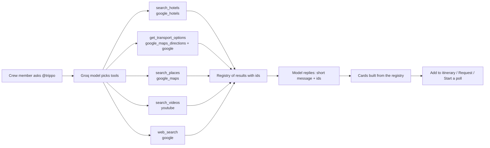
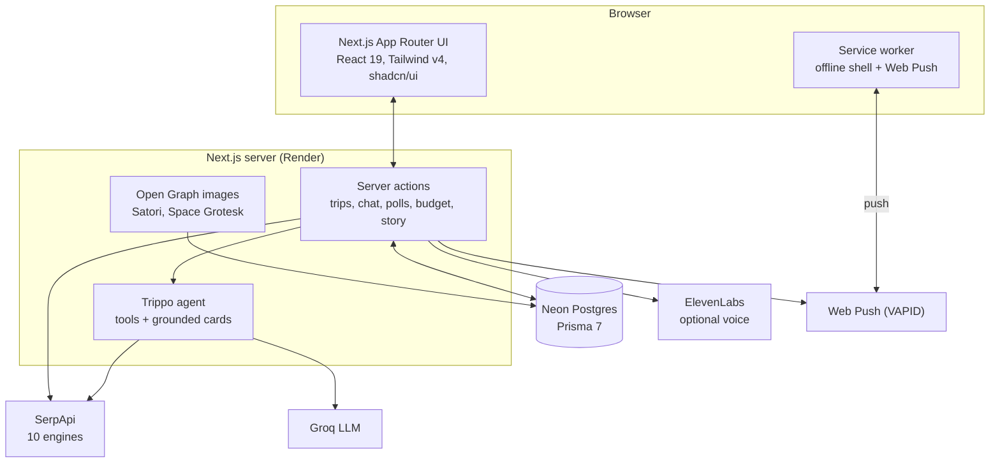

# Trippo

**Group trips, minus the group-chat chaos.** Trippo is one place for a friend group to go from
"where should we go?" to "who owes whom ₹340?": preferences, an AI itinerary built from real
places and real flights, voting, a crew chat with an AI that answers with live data, a live map,
a shared budget and a narrated story of the finished trip.

|  |  |
| --- | --- |
| **Live app** | https://trippo-web.onrender.com |
| **Code** | https://github.com/Karthikeyan1508/trippo |
| **Built for** | SerpApi India Hackathon 2026, Travel & Local Discovery |
| **Stack** | Next.js 16, React 19, Tailwind v4, Prisma 7 + Neon Postgres, Auth.js, SerpApi, Groq |

Every hotel, price, route, train time, photo and video you see in Trippo comes from a SerpApi
call. The AI decides what to look up and writes a short recommendation; it is never the source of
a fact (see [How SerpApi is used](#how-serpapi-is-used)).

---

## Contents

1. [Take the 3 minute tour](#take-the-3-minute-tour)
2. [What Trippo does](#what-trippo-does)
3. [How SerpApi is used](#how-serpapi-is-used)
4. [@trippo, the crew chat AI](#trippo-the-crew-chat-ai)
5. [How the itinerary route is built](#how-the-itinerary-route-is-built)
6. [The trip story](#the-trip-story)
7. [Architecture](#architecture)
8. [Getting started](#getting-started)
9. [Configuration](#configuration)
10. [Scripts and tests](#scripts-and-tests)
11. [Deployment](#deployment)
12. [Project layout](#project-layout)
13. [Design system](#design-system)
14. [Security and privacy](#security-and-privacy)
15. [Limits and honest caveats](#limits-and-honest-caveats)
16. [AI tools used](#ai-tools-used)

---

## Take the 3 minute tour

Sign in with Google at the live app (or use the dev sign-in locally, see
[Getting started](#getting-started)), create a trip, and try these in order:

1. **Create a trip** with an origin city and a destination (for example Bengaluru to Sri Lanka).
   Share the invite link; the link has its own social preview card.
2. **Share preferences**, then press **Generate itinerary**. Trippo picks flights or road, places
   bases inside the destination, orders stops along the shortest path and respects real flight
   times. The map numbers every stop.
3. Open **Crew chat** and type `@trippo top 3 hotels near Colombo`. You get hotel cards with real
   photos and prices. Then try `@trippo how do we get from Colombo Fort to Kandy?` for train, bus,
   cab and scooter options with times and fares, and `@trippo suggest YouTube videos for our
   itinerary` for videos that are verifiably about your stops.
4. On any card, **Add to itinerary** (admin: instant; member: a request the admin approves) or
   **Start a poll** so the crew decides. Polls and votes live in the chat.
5. **Approve** the plan from each account. When everyone approves, the plan locks and the **Story**
   tab unlocks: an admin creates the narrated 3D fly-through once and can share just that story
   on a public link.

## What Trippo does

Trippo follows the way a group actually plans, in five stages. The **Overview** shows each person
the single next thing they should do.

| Stage | What happens |
| --- | --- |
| **1. Invite your crew** | One shareable link (WhatsApp ready, with a generated preview image). Friends sign in and land on the trip. |
| **2. Share preferences** | Diet, pace, budget, interests, accessibility needs. Group insights show where people agree. |
| **3. Build the plan** | SerpApi research plus an LLM turn the group's answers into a day by day itinerary. Admins edit, reorder and add stops. |
| **4. Approve together** | Everyone votes. The plan locks when all voters agree; any edit clears the votes. |
| **5. Get ready and go** | Prep guide, private packing checklist, live crew map, shared budget with settle up, gear shopping, the trip story. |

Around those stages:

- **Crew chat with `@trippo`**: group chat, mentions, replies, polls, and an AI that searches live
  data. Cards go straight into the itinerary or into a vote.
- **Live crew map**: each person's last known location, shown greyed out with a "last seen" time
  when they have location off.
- **Shared budget**: expenses with unequal splits, edit approval, currency conversion at the rate
  of the day, and a settle up that minimises payments.
- **Gear and shopping**: trip specific product ideas through SerpApi's `amazon` engine, with a
  crew list everyone can vote on.
- **Notifications**: an in app inbox per trip, plus real device notifications (Web Push) for what
  needs you: polls, mentions and replies to your messages.
- **Installable (PWA)**: add to home screen, offline shell, works on phone and desktop.
- **Light, dark and system themes**, with a design built around square corners, glass surfaces and
  a lime accent (see [Design system](#design-system)).

## How SerpApi is used

SerpApi is Trippo's source of truth. The project uses **ten** SerpApi engines, each for a job
that matters to the product.

| Engine | Used for | Where |
| --- | --- | --- |
| `google_flights` | Real one way fares and times for trips that need a flight. The earliest sensible arrival and a late direct return set the usable time of each day. | `src/server/route-planner.ts`, `src/server/serpapi.ts` |
| `google_maps` | Attractions, sights and places with coordinates, ratings, hours and photos. Powers the itinerary stops and the "things to do near X" cards. Also geocodes the names people type. | `src/server/serpapi.ts`, `src/server/itinerary.ts` |
| `google_local` | Restaurants and local spots for meals, filtered by the crew's diet. | `src/server/serpapi.ts`, `src/server/route-itinerary.ts` |
| `google_hotels` | Hotels near any stop with nightly and total price, rating, amenities and nearby landmarks. | `src/server/trippo-tools.ts` |
| `google_maps_directions` | "How do we get from A to B?" Driving, public transit (train and bus operators with departure and arrival times), two wheeler and walking. | `src/server/trippo-tools.ts` |
| `google` | Local fare snippets, general questions, and the answer box currency converter used to show fares in the crew's own currency. | `src/server/serpapi.ts` |
| `youtube` | Videos that match the itinerary's stops. | `src/server/trippo-tools.ts` |
| `google_images` | Photos of each place for the trip story. | `src/server/serpapi.ts`, `src/server/story.ts` |
| `google_events` | Events happening during the trip dates. | `src/server/serpapi.ts` |
| `amazon` | Gear and shopping ideas specific to the trip. | `src/lib/amazon.ts`, `src/server/products.ts` |

### Principles that make the usage meaningful

- **The AI never states a fact it was not handed.** The chat model chooses tools and writes two to
  four sentences. Every card (hotel, route, place, video) is built from the tool results by id,
  never from text the model wrote, so there are no invented hotels, prices or fares.
- **Computed, not guessed.** The fastest route is computed in code from the directions data; hotel
  ranking weighs ratings by review count (a 5.0 from twelve reviews does not beat a 4.7 from
  thousands); fares appear only if a source snippet gave one, in its own currency, with a
  converted figure.
- **Credit aware.** Every SerpApi response is cached per trip for 7 days
  (`ResearchQuery` table), so repeated questions and page loads do not spend credits. A hotel
  question costs about one to two searches, a transport question about six, a video question up to
  three.
- **Graceful without keys.** With no `SERPAPI_API_KEY` or `GROQ_API_KEY` the app still runs and
  generates a clearly labelled sample plan.

## @trippo, the crew chat AI

Anyone in the crew chat can type `@trippo` followed by a question. The flow:



What makes it trustworthy and useful:

- **Cards, not paragraphs.** Hotels show photo, nightly and total price, rating, amenities and
  distance. Transport shows every realistic way (cab, train, bus, scooter, walking) with duration,
  distance, departure and arrival times and a fare when a source gave one. Places show photo,
  rating, hours and distance.
- **Videos that are actually about your trip.** Videos are kept only if the title names the stop
  and the destination. Live streams, Shorts, compilations ("top 25 places") and barely watched
  videos are dropped; length, age and views then rank what is left. Each card says which stop it
  is about and plays in the chat.
- **Admin adds, member requests, crew votes.** An admin's "Add to itinerary" applies at once (in
  time order, and the plan's votes reset). A member's becomes a request the admins approve in the
  thread. "Start a poll" turns the chosen cards into a private vote; while a poll is open the card
  shows "Poll created" and cannot be polled again.
- **Chat that feels live.** Short polling with a `since` cursor, optimistic sending, presence,
  unread badges, jump to a message, reply quotes and `@name` mentions.
- **Protected quotas.** 10 questions per person per hour and 60 per trip per day. The Groq free
  tier is token limited, so prompts and tool output are kept lean, and rate limit responses are
  waited out and retried; a model that returns its reply in an odd shape is recovered rather than
  failed.
- **Device notifications for what needs you.** Polls, mentions and replies to your messages reach
  your phone or desktop; plain chat does not.

## How the itinerary route is built

Plans are built route first, so they are travellable and not just a list of places:

1. **Gateway and mode.** From the trip's origin city and destination, Trippo decides flight or
   road (`src/lib/airports.ts`). For flights it fetches real fares and times from
   `google_flights`.
2. **Bases.** The model proposes where to sleep; code keeps only bases inside the chosen
   destination, rejects any leg too long for the trip length (for example 90 minutes by road for a
   trip of three days or fewer) and orders the loop to be the shortest (`src/lib/geo.ts`, exact up
   to 12 stops).
3. **Days.** Each day gets a time window set by the real flights and transfers, and a set of nearby
   places ordered along the shortest path, so a day never zigzags.
4. **Wording.** The model only writes the free time parts around that fixed skeleton, and its
   output is checked against it: invented far off places are dropped and times are repaired.

Without an LLM key the same skeleton produces a complete deterministic plan.

## The trip story

The **Story** tab is a cinematic, narrated 3D fly-through of the plan: a map that travels stop to
stop, photos of each place (`google_images`) and a voice-over.

- **Once, by an admin, after the crew approves.** The story is created from the final plan, saved
  in `TripStory`, and never regenerated, so research, narration and voice credits are spent once.
  Crew members can ask an admin to create it.
- **Shareable on its own.** An admin can create a public link (`/story/<token>`) that shows only
  that story: no crew, plan, budget or chat, and no sign in. Stopping sharing deletes the token and
  the old link becomes a 404. Shared links have a generated preview image in the app's typeface.
- **A connected route.** Each hop between stops is its own line: a road route where one exists, a
  dashed straight line for flights and sea crossings. Stops at the same spot share one marker with
  all their numbers.
- **Adapts to the screen.** Portrait phone, landscape phone and desktop each get their own layout.

## Architecture



Decisions worth knowing:

- **One Next.js app, no separate backend.** Mutations are server actions; reads happen in server
  components. Auth.js v5 uses JWT sessions with the Prisma adapter on Neon.
- **Polling, not websockets.** The chat polls a cursor (`getChat` with `since`): fast while Trippo
  is thinking, slow when the tab is hidden. `ChatMessage.updatedAt` is touched on every change so
  votes, card states and request decisions reach everyone on the next poll. This suits a free
  hosting plan with no persistent connections.
- **Plan integrity.** `syncPlanState` is the single source of truth for "is the plan approved?"
  and is called after anything that can change it: a vote, a member leaving, an edit.
- **Map choices.** Leaflet with OpenStreetMap for the itinerary and live map (free, no billing),
  MapLibre GL for the 3D story. SerpApi supplies place data, never map tiles.
- **Data model** (Prisma, 18 migrations): `Trip`, `TripMember` (roles ADMIN, MEMBER, OBSERVER),
  `Preference`, `Itinerary` > `ItineraryDay` > `ItineraryItem`, `Approval`, `Poll` and `PollVote`,
  `ChatMessage`, `ItineraryRequest`, `Expense` with shares and edits, `Settlement`,
  `ProductSuggestion`, `MemberLocation`, `Notification`, `PushSubscription`, `TripStory`, and
  `ResearchQuery` (the SerpApi cache).

## Getting started

Prerequisites: Node 22 or newer, a Postgres database (Neon recommended), and the API keys below.

```bash
git clone https://github.com/Karthikeyan1508/trippo.git
cd trippo
cp .env.example .env       # fill in the values (see Configuration)
npm install
npx prisma migrate deploy  # create the tables
npm run dev                # http://localhost:3000
```

- **Signing in locally.** In development a "Dev sign in" box on `/login` lets you sign in with any
  email, so you can try the multi person flows (invite, vote, chat) without Google. It is never
  enabled in production.
- **Trying the multi person flows alone.** Open a second browser profile or a private window,
  sign in with another email, and use the invite link from the first account.
- **Production build.** `npm run build && npm run start`. The dev server (Turbopack) can lag on
  brand new Tailwind classes, so verify styling on a production build.
- **Google sign in.** Create an OAuth client and add
  `http://localhost:3000/api/auth/callback/google` (and your deployed
  `https://<host>/api/auth/callback/google`) to its authorised redirect URIs.

## Configuration

| Variable | Required | Purpose |
| --- | --- | --- |
| `DATABASE_URL`, `DIRECT_URL` | Yes | Neon pooled URL (runtime) and direct URL (migrations) |
| `AUTH_SECRET` | Yes | Auth.js session signing key (`openssl rand -base64 32`) |
| `AUTH_GOOGLE_ID`, `AUTH_GOOGLE_SECRET` | Yes | Google sign in |
| `AUTH_TRUST_HOST` | Behind a proxy | Set to `true` on Render so Auth.js trusts the forwarded host |
| `SERPAPI_API_KEY` | For live data | Every place, hotel, flight, route, photo, video and event |
| `GROQ_API_KEY`, `GROQ_MODEL` | For AI | Itinerary wording, prep guide, story narration (default `openai/gpt-oss-120b`) |
| `GROQ_CHAT_MODEL` | Optional | Model for `@trippo` (defaults to `GROQ_MODEL`) |
| `ELEVENLABS_API_KEY`, `ELEVENLABS_VOICE_ID` | Optional | Premium story voice; falls back to the browser's voice |
| `NEXT_PUBLIC_VAPID_PUBLIC_KEY`, `VAPID_PRIVATE_KEY`, `VAPID_SUBJECT` | Optional | Device notifications. Generate with `npx web-push generate-vapid-keys`; the subject is a `mailto:` or https URL. The public key is inlined at build time, so set it before building. Without these, the in app inbox still works |

Without `SERPAPI_API_KEY` and `GROQ_API_KEY` the app still works and produces a clearly labelled
sample plan, which is handy for exploring the UI.

## Scripts and tests

```bash
npm run dev        # development server
npm run build      # production build
npm run start      # serve the production build
npm run lint       # eslint
npx tsc --noEmit   # typecheck
npm test           # unit tests (node:test via tsx)
```

Contributor notes:

- The active trip section lives in the URL (`?tab=itinerary`), so every section is deep linkable.
  Add a section in `nav-config.ts`, then render a `<TabsPrimitive.Content value="...">` for it in
  `page.tsx`.
- This Next.js version differs from older releases (for example `middleware` is `proxy`). Read
  `node_modules/next/dist/docs/` before changing framework level code.
- Anything that can change who has approved the plan must call `syncPlanState(tripId)`.
- Server action files (`"use server"`) may only export async functions; shared helpers live in
  plain modules.

## Deployment

`render.yaml` describes a Render web service (free plan). Create it with **New > Blueprint**
pointing at the repository, then fill in the variables marked `sync: false`. Migrations run during
the build (`prisma migrate deploy`), and pushes to `main` deploy automatically. After the first
deploy, add `https://<service>.onrender.com/api/auth/callback/google` to the Google OAuth client's
authorised redirect URIs. `docs/render-mcp.md` explains driving Render from an MCP client.

## Project layout

```
src/app/(app)/trips/[id]/        the trip workspace: one server page plus a component per section
src/app/(app)/trips/[id]/chat/   crew chat UI: messages, cards, polls, composer
src/app/join/[code]/             public invite landing page and its share image
src/app/story/[token]/           public shared story and its share image
src/lib/                         pure logic: journey, plan state, geo, airports, budget, OG cards
src/server/                      server actions and integrations
  serpapi.ts                       cached SerpApi client and the engine wrappers
  trippo-ai.ts, trippo-tools.ts    the @trippo agent and its SerpApi tools
  chat.ts, chat-core.ts            chat actions and shared chat queries
  route-planner.ts, route-itinerary.ts   route first itinerary
  story.ts, story-route.ts         trip story creation and route building
  notify.ts, push.ts               in app and device notifications
prisma/                          schema and migrations
public/sw.js                     service worker: offline shell and push
```

## Design system

The UI follows the shadcn preset `b3Sm9Pe4Y` (style `radix-sera`, Space Grotesk, a lime primary).
House rules live in `src/app/globals.css`:

- **Square corners everywhere**: `--radius` is 0 and a global reset catches any `rounded-*` class.
- **Glass surfaces**: cards, the sidebar and sticky bars are translucent and blurred over a very
  mild WebGL shader.
- **Light, dark and system**, chosen in Settings with quick toggles in the headers. Use
  `text-brand` (not `text-primary`) for accent text: the lime is too light to read on white.
- **Everything clickable** shows a pointer cursor and a hover highlight; scrollbars are slim and
  square.
- **One typeface**, including generated share images (Space Grotesk is bundled as TTF for them).

## Security and privacy

- **Membership checks on every action.** Reads and writes verify the caller belongs to the trip and
  has the role the action needs (admin only: create the story, share it, approve requests).
- **The public story is the only public surface besides the invite page.** It reads a single saved
  story by an unguessable token and nothing else about the trip.
- **No secrets in the client.** Keys stay on the server; only the public VAPID key is exposed.
- **Rate limits** on chat, AI questions and paid narration protect users and quotas.
- **Untrusted text is data.** Chat messages and web snippets are never treated as instructions by
  the AI, and model output is cleaned (no stray ids, links are validated as http or https).
- **Location is shared only with your own crew**, and a person who turns it off shows as "last
  seen" rather than being tracked.

## Limits and honest caveats

- Hosting is on free tiers, so the first request after idle can be slow while the service wakes.
- Groq's free tier has a small tokens per minute budget; heavy simultaneous use of `@trippo` can
  fall back to showing results with a generic one line message.
- SerpApi results depend on what Google returns for a place; a very obscure stop can come back with
  no video or no hotel rather than a loose match, by design.
- Fares appear only when a source snippet gives one; otherwise Trippo says so instead of guessing.
- "Always on" live location works while Trippo is open in a browser or installed app, not as a
  background service.
- Device notifications need each person to allow them in Settings (and in the operating system).

## AI tools used

- **Claude Code** helped design, build and test the app and drafted documentation.
- **Groq (`openai/gpt-oss-120b`)** powers `@trippo`, itinerary wording, the prep guide and story
  narration at runtime, always on top of SerpApi data.
- **ElevenLabs** (optional) provides the premium voice-over for the trip story.
